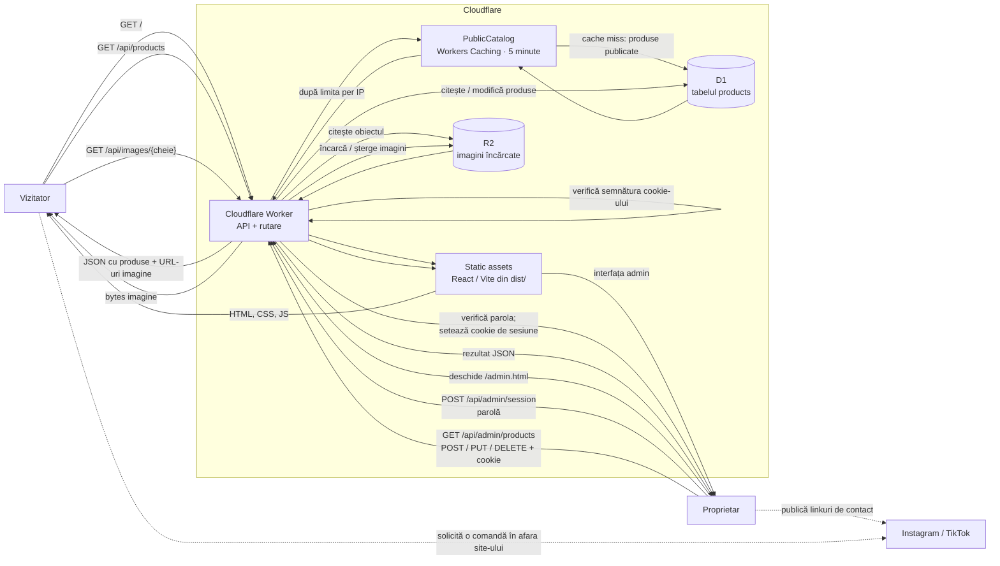

# Arhitectura Snuggle Stitches

## Schema de ansamblu

## Cum circulă datele

### Vizitatorul și catalogul public

1. Browserul cere site-ul de la Worker. Worker-ul trimite fișierele statice construite de Vite (`dist/`) prin binding-ul `ASSETS`.
2. Aplicația React cere `GET /api/products`.
3. Worker-ul verifică limita de 240 cereri API publice/minut/IP, apoi apelează entrypoint-ul intern `PublicCatalog`, cu cache de 5 minute. Numai la cache miss citește din D1 rândurile cu `is_published = 1`, le ordonează și le trimite ca JSON. Gateway-ul și răspunsul către browser nu sunt cache-uite.
4. React afișează produsele și construiește filtrele din categoriile produselor primite.
5. Pentru o imagine încărcată în R2, browserul cere URL-ul `/api/images/{cheie}`. Worker-ul citește obiectul din R2 și transmite conținutul imaginii. Produsele pot folosi și un URL HTTPS extern sau o imagine locală din `/images/`, caz în care imaginea nu trece prin R2.

### Proprietarul și administrarea

1. Proprietarul deschide `/admin.html` și introduce parola comună a administratorului.
2. Interfața trimite parola prin `POST /api/admin/session`, limitat la 5 cereri/minut/IP. Worker-ul o compară cu secretul `ADMIN_PASSWORD` și returnează un cookie de sesiune semnat, `HttpOnly`, `SameSite=Strict` și `Secure` în producție. Cookie-ul expiră după 24 de ore.
3. Cererile către API-ul admin includ automat cookie-ul. Worker-ul îi verifică semnătura și expirarea înainte să permită accesul la produse.
4. Interfața trimite `GET` pentru listă, `POST` pentru creare, `PUT` pentru editare și `DELETE` pentru ștergere. Worker-ul validează datele și imaginea încărcată; pentru upload nou, scrie imaginea în R2 și apoi datele produsului în D1.
5. La editarea sau ștergerea unui produs, Worker-ul elimină vechea imagine din R2 când este cazul. După orice modificare, inclusiv reordonare, cere ștergerea cache-ului public din entrypoint-ul intern. Dacă ștergerea cache-ului eșuează, returnează un avertisment; datele vechi pot rămâne până la 5 minute. Lista admin este mereu citită din D1, fără cache.
6. Celelalte cereri admin au o limită separată de 60 cereri/minut/IP, verificată înainte de autentificare. Depășirea oricărei limite API produce `429` și `Retry-After: 60`. Limitele Cloudflare sunt aproximative și per locație, nu un plafon global de trafic sau cost.

### Ce se stochează unde

- **D1 (`products`)**: nume, descrieri, text alternativ, categorie, preț minim/maxim, stare publicat/draft, ordine, URL/cheia imaginii și metadatele produsului. D1 stochează cheia imaginii din R2, nu conținutul fotografiei.
- **R2 (`snuggle-stitches-images`)**: bytes pentru imaginile încărcate din formularul admin. Worker-ul le servește prin `/api/images/`.
- **Assets (`dist/`)**: frontend-ul compilat și fișierele statice ale site-ului.
- **Worker secret `ADMIN_PASSWORD`**: parola comună, configurată separat de cod. Worker-ul o folosește pentru autentificare și semnarea sesiunilor.

## Limita actuală a fluxului de comenzi

Site-ul este un catalog și o vitrină. Butoanele de contact deschid profilurile Instagram sau TikTok. **Nu există formular de comandă, endpoint de comandă, plată sau înregistrare a solicitărilor în D1.** Conversația și solicitarea comenzii au loc pe platforma socială aleasă de vizitator.

## Dezvoltare și publicare

- `npm run dev` pornește Vite; proxy-ul din `vite.config.ts` trimite cererile `/api` către Worker-ul local de la portul `8787`.
- `npm run dev:worker` pornește Worker-ul local, cu binding-uri locale D1 și R2.
- `npm run build` compilează frontend-ul în `dist/`.
- `npm run deploy` construiește frontend-ul și publică Worker-ul cu assets.
- Migrațiile D1 se aplică separat cu `npm run db:migrate:remote`; publicarea codului nu înlocuiește aplicarea migrațiilor.
- În producție configurează `ADMIN_PASSWORD` cu `npx wrangler secret put ADMIN_PASSWORD`, folosind o parolă aleatoare de cel puțin 32 de caractere. Dacă ai configurat anterior Cloudflare Access pentru `/admin.html` sau `/api/admin/*`, dezactivează acele reguli pentru a evita redirecționarea la autentificarea veche.

## Cod de urmărit

- [Frontend public](./src/App.tsx) — încarcă și afișează catalogul.
- [Frontend admin](./src/admin/AdminApp.tsx) — formularul de administrare și cererile CRUD.
- [API Worker](./src/worker/index.ts) — rute, acces, citire/scriere D1 și imagini R2.
- [Modelul produsului](./src/worker/products.ts) — validare și transformarea dintre rândurile D1 și JSON.
- [Configurația Cloudflare](./wrangler.jsonc) — assets, binding-urile D1 și R2.
- [Migrațiile bazei de date](./migrations/) — schema D1.
